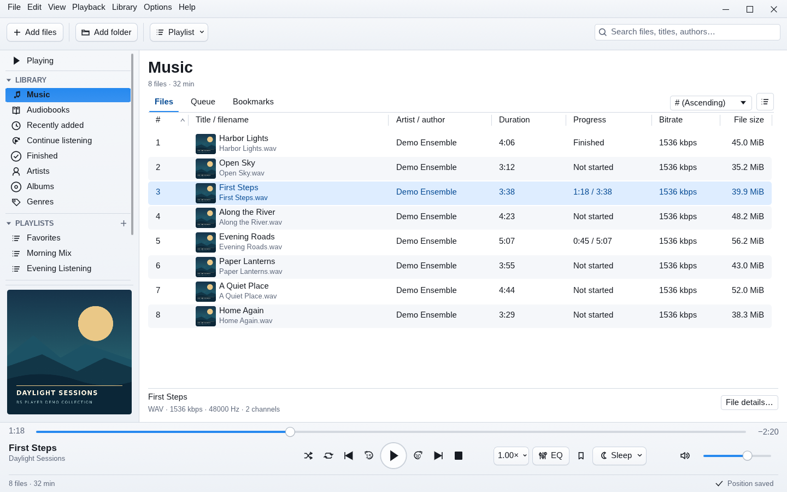
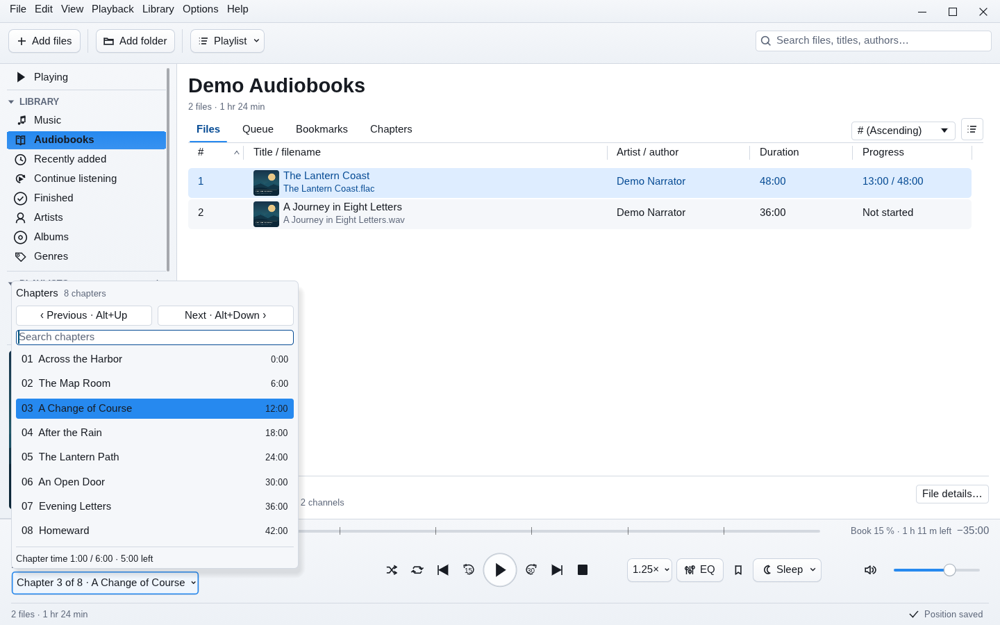
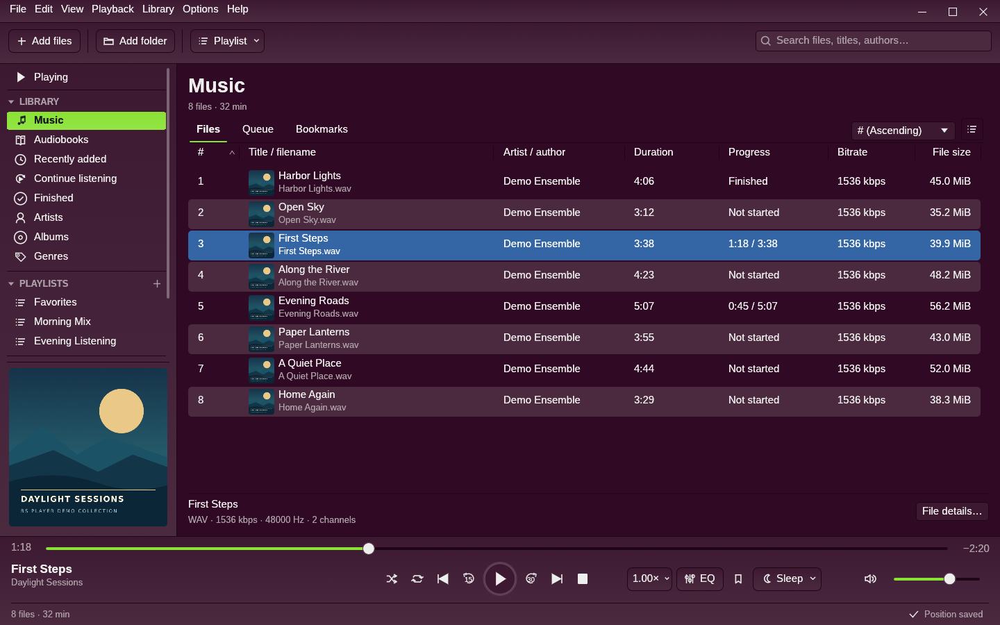
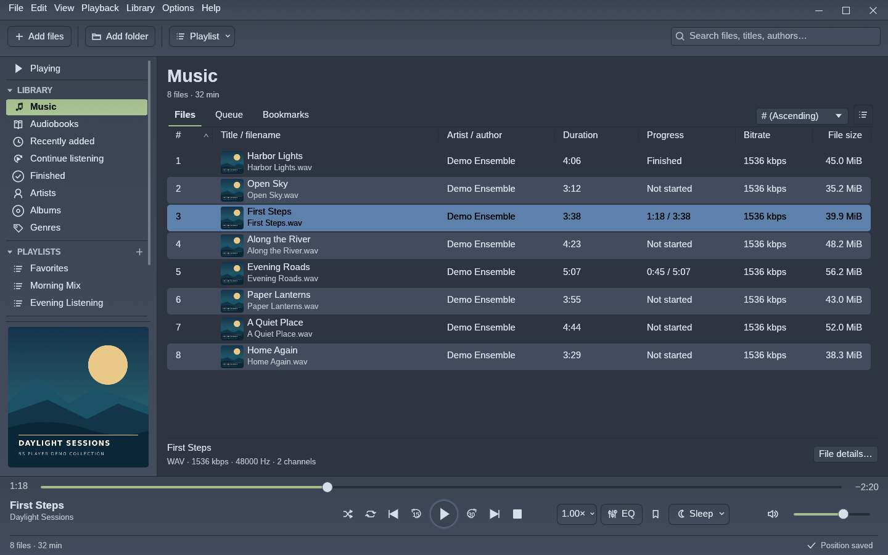
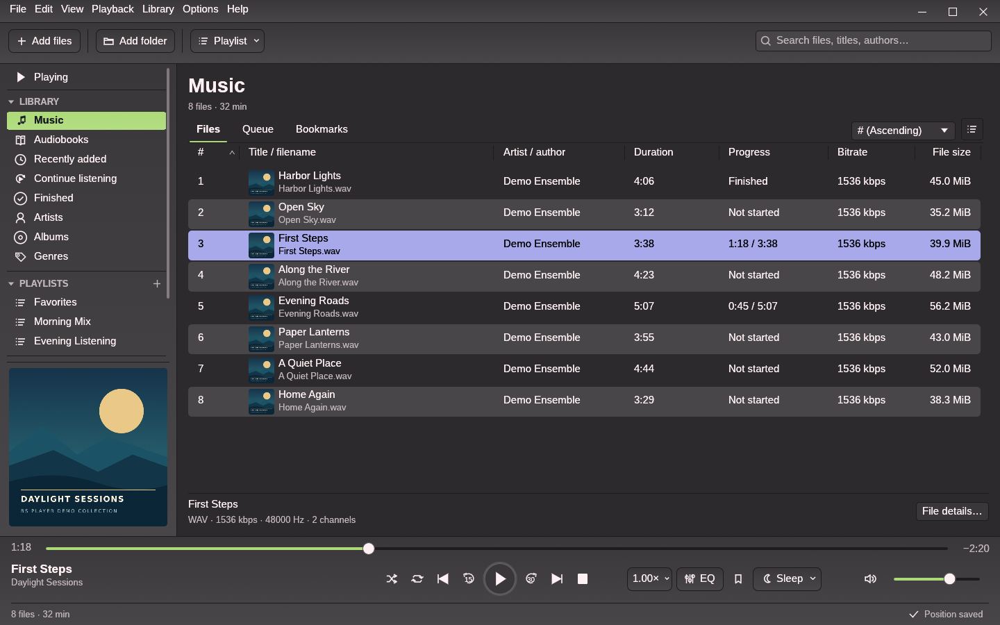
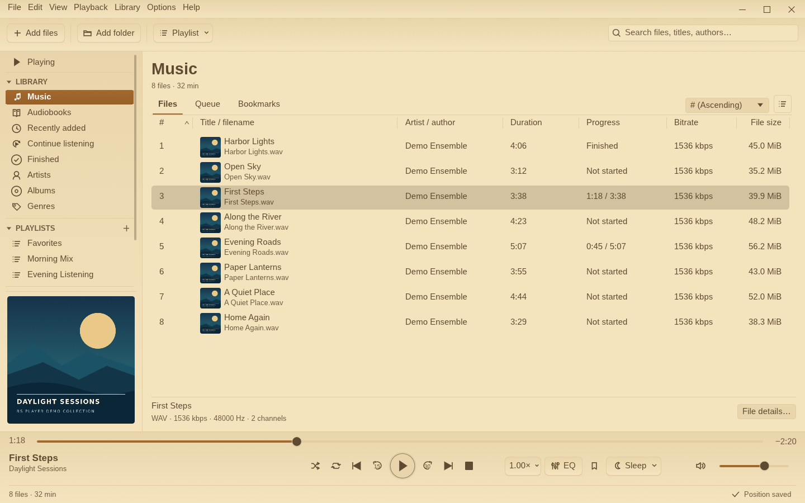

# BS Player

BS Player is a music, audiobook and internet-radio player built in Rust with a
focus on speed, responsiveness and low memory usage. Your library, playlists,
listening positions and bookmarks stay in a portable profile beside the app.

Version **0.9.1** is for **Windows 10/11, x86-64**. It is a
generic Intel/AMD build (x86-64-v1) and does not require AVX2 or AVX-512. Source
code also supports Linux and macOS; packages for those systems are not part of
this Windows release.

## Screenshots

Captured with generated demo entries, silent test files and demo artwork.

Audiobook chapters and color themes

| Deep Plum | Polar Slate |
| --- | --- |
|  |  |
| **Warm Charcoal** | **Parchment** |
|  |  |

## Features

- Music and audiobook library with search, playlists, queue, favorites and
  28 configurable, sortable library columns.
- Internet radio with saved stations, HTTP/HTTPS streams, M3U/PLS playlists,
  live track titles and automatic reconnects.
- Remembers listening position, bookmarks and playback speed; supports chapters,
  sleep timer, silence skipping and speed changes with pitch preserved.
- Gapless playback, ten-band equalizer, ReplayGain, shuffle, repeat and A–B
  repeat.
- Light, dark and system appearance, with named color themes.
- Plays MP3, FLAC, Ogg Vorbis, Opus, WAV, AIFF, AAC and supported M4A/M4B audio.
  MP4 and MKV containers are read as audio only; video and subtitles are not
  played. Dolby, DTS and WMA audio, and surround-channel Opus, are unsupported.

## Windows setup

When v0.9.1 is published, get the Windows x86-64 package from
[GitHub Releases](https://github.com/IronWolve/BS-Player/releases). Extract it
to a writable folder and run `bs-player.exe`. Keep the adjacent `profile/`
folder when updating; it contains your portable settings and listening data.
The Windows application is unsigned, so Windows may show a security prompt.

## License

BS Player is licensed under [Apache License 2.0](LICENSE).
